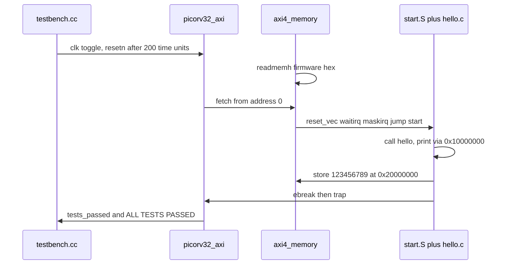

# PicoRV32 tutorial (English summary)

Full walkthrough: **[TUTORIAL_zh.md](TUTORIAL_zh.md)** (Chinese).
Proven logs: **[logs/](logs/)**. Command index: **[LEARNING.md](LEARNING.md)**.

## What PicoRV32 is

A size-optimized **RV32I/E/M/C** Verilog CPU (optional IRQ + PCPI multiply/divide)
aimed at FPGA/ASIC glue processors. One file, `picorv32.v`, holds the core and
the AXI / Wishbone wrappers. Reset PC is `0x0`. Native memory handshake:

`mem_valid` / `mem_ready` / `mem_addr` / `mem_wdata` / `mem_wstrb` / `mem_rdata`.

This repository is `weiwan-gmail/picorv32` (fork of YosysHQ/picorv32). Work
here is on **develop**. Upstream already had `make test_verilator`; this fork
makes that path practical on Ubuntu (toolchain auto-detect, Verilator 5,
hello-only firmware, tutorials). Core RTL is unchanged.

**Co-sim choice:** compile C firmware to a `.hex` image and load it with
`$readmemh`. The Verilator C++ file only drives clock/reset. That matches how
PicoRV32 was written; a separate C ISS is not added.

## Repo map

| Path | Role |
|------|------|
| `picorv32.v` | CPU + AXI/WB adapters + PCPI mul/div |
| `testbench.v` | `picorv32_wrapper` + `axi4_memory` (RAM + UART + pass MMIO) |
| `testbench.cc` | Verilator clock/reset; optional `+vcd` / `+trace` / `+max-cycles=` |
| `testbench_ez.v` | six hardcoded instructions; no GCC |
| `firmware/` | C + `start.S`; `HELLO_ONLY` builds `hello.hex` |
| `tests/*.S` | riscv-tests fragments linked into the **full** firmware |
| `firmware/makehex.py` | little-endian `.bin` → one 32-bit hex word per line |
| `picosoc/` | SPI-flash SoC example (FPGA; not this tutorial) |

## How firmware boots



1. `$readmemh` fills 128 KiB of TB RAM (`firmware/hello.hex` or `firmware.hex`).
2. `reset_vec` (16 bytes at 0) waits for the first IRQ, unmasks IRQs, jumps to `start`.
3. `start` zeros registers, sets `sp` to 128 KiB, calls `hello()` (`print_str("hello world\n")`).
4. Hello-only firmware skips ISA/sieve/mul/stats, prints `DONE`, stores `123456789` at `0x20000000`, `ebreak`s.
5. The IRQ handler prints the EBREAK dump (expected). The CPU `trap`s. If the magic store happened, the TB prints **`ALL TESTS PASSED.`**

## Install tools

```bash
sudo apt-get install -y iverilog verilator gcc-riscv64-unknown-elf python3 build-essential
make toolchain-info
```

Verified here: Icarus 12.0, Verilator 5.020, `riscv64-unknown-elf-gcc` 13.2.0.

**`TOOLCHAIN_PREFIX`:** compiler prefix including the trailing `-`. The
Makefile prefers `/opt/riscv32i/...` when present, else PATH
(`riscv64-unknown-elf-`, xpack `riscv-none-elf-`, …). GCC 10+ needs
`rv32imc_zicsr` for `rdcycle` in the **full** firmware; hello-only does not
use CSRs but the same march is fine.

## Build C → Verilator → Icarus

```bash
make test_verilator_hello
# hello world
# DONE
# ALL TESTS PASSED.
# verilator_exit=0 tests_passed=1 cycles=35845

make test_hello
# same UART text, Icarus; ALL TESTS PASSED.

make test_verilator
# full suite; ALL TESTS PASSED. cycles=477300
```

Optional VCD: `./testbench_verilator +firmware=firmware/hello.hex +vcd`

## PASS / FAIL

- **PASS:** `ALL TESTS PASSED.` and (Verilator) `verilator_exit=0`.
- **FAIL:** `ERROR!` / `verilator_exit=1` — trap without the magic store.
- **Timeout:** `TIMEOUT after N clock cycles` / `verilator_exit=2` (default 2e6).

The EBREAK ASCII dump is **not** a failure.

Logs from a real run:

- Icarus hello: [logs/04-iverilog-hello.txt](logs/04-iverilog-hello.txt)
- Verilator hello: [logs/05-verilator-hello.txt](logs/05-verilator-hello.txt)
- Verilator full firmware: [logs/06-verilator-firmware.txt](logs/06-verilator-firmware.txt)

## Next: FemtoRV, darkriscv, SERV

- **FemtoRV** (`learn-fpga`): teaching SoCs; compare UART/linker scripts with this hex load.
- **darkriscv:** another compact from-scratch RV32; compare with single-file `picorv32.v`.
- **SERV:** bit-serial RISC-V; same ISA, ~1 bit per cycle.

Stay on this tree until `make test_verilator_hello` is green, then read
`picorv32.v` around the `mem_*` handshake and `ENABLE_IRQ`.
