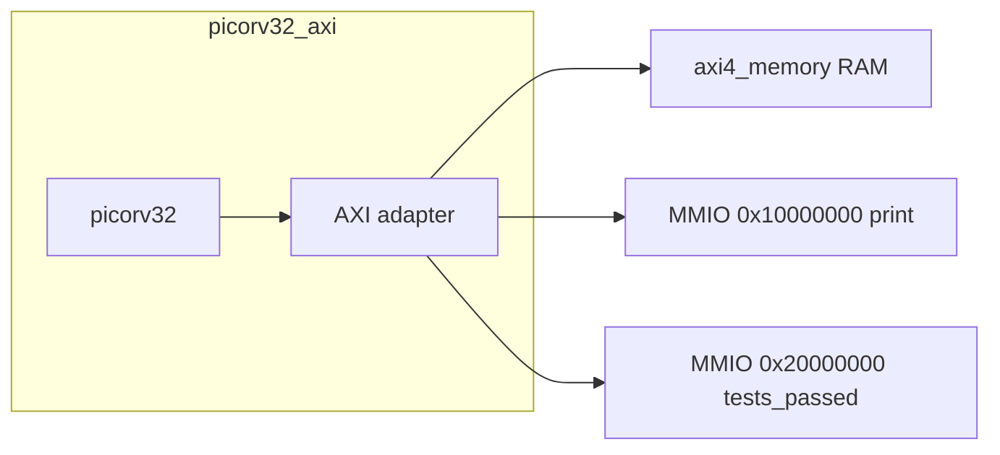
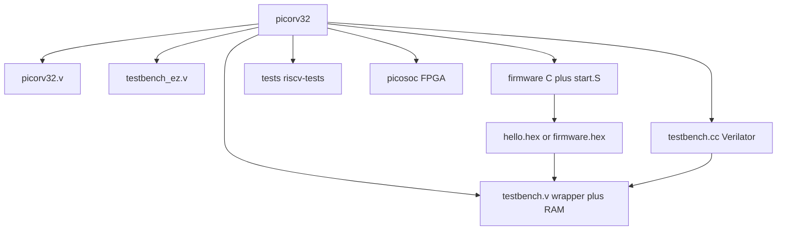
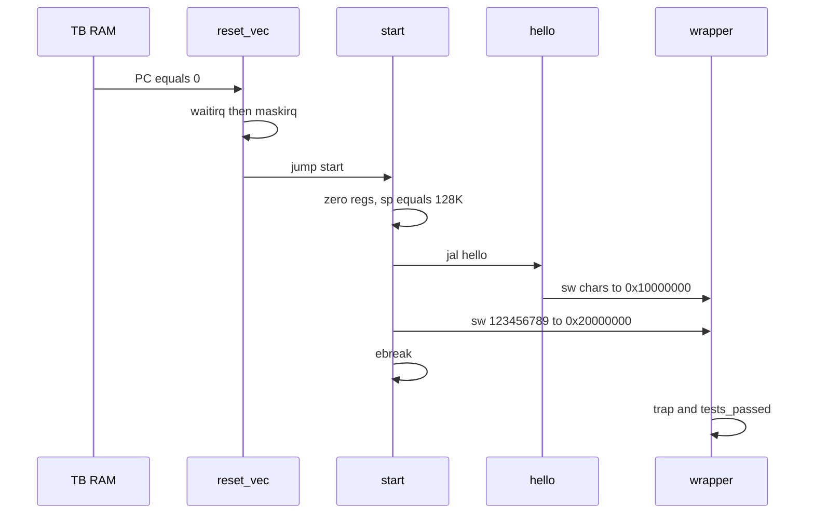

# PicoRV32 学习教程（中文主文档）

面向 Wei 的完整上手说明：从仓库结构、固件如何从地址 0 启动，到用
**C 交叉编译 → hex 灌 RAM → Icarus / Verilator 同镜像仿真** 跑通
`hello world`（以及完整 `firmware.hex` 自检）。

英文摘要：[TUTORIAL.md](TUTORIAL.md)
命令速查：[LEARNING.md](LEARNING.md)
本教程里每一条关键命令都在 [logs/](logs/) 里有**真实终端输出**，不是口头推演。

> 工作分支：`weiwan-gmail/picorv32` 的 **develop**（上游为
> [YosysHQ/picorv32](https://github.com/YosysHQ/picorv32)）。
> **不改 CPU 流水线 RTL**（`picorv32.v` 保持原样）。只补了工具链探测、
> Verilator 5 下的 C++ 时钟驱动、一份 hello-only 固件，以及本教程。
>
> 上一档梯子是 tinyriscv（三级流水 + RIB 总线 + `inst.data`）。PicoRV32
> 是另一种小 RV32：**单文件核 + `mem_valid/ready` 握手**，固件以 hex 字
> 载入 TB RAM，而不是单独的 ROM 外设。

---

## 0. 选了哪种 co-sim，为什么

PicoRV32 **本来就**把 C 固件编成 `firmware.hex`，testbench 用 `$readmemh`
灌进 RAM，再用 Icarus 或 Verilator 跑。`testbench.cc` 只负责翻转 `clk` /
拉 `resetn`（Verilog 里的 `#5` 时钟在 `` `ifndef VERILATOR `` 里，Verilator
用不了）。

所以这里采用 **「C 固件 hex + Verilator C++ 时钟驱动」**，而不是再写一个
C 指令集模拟器去对拍。对这个仓库来说，hex 路径才是自然 co-sim：CPU 真正
执行交叉编译出来的机器码，C++ 侧不是第二套 CPU。

学习用 demo 是 **hello-only**（`make test_verilator_hello`）：打印
`hello world`，写入魔数，TRAP 后 `ALL TESTS PASSED.`。完整
`firmware.hex`（ISA + sieve + mul + stats）仍然可用
`make test_verilator`，上游 Makefile 目标名没改。

---

## 1. PicoRV32 是什么

Claire Wolf 写的面积优化 **RV32I/E/MC** 核，可配 IRQ 和 PCPI 协处理器
（仓库里带了 MUL/DIV）。典型用途是 FPGA / ASIC 里的辅助处理器：面积小、
fmax 高。三种外壳：

| 模块 | 总线 |
|------|------|
| `picorv32` | 原生 `mem_valid` / `mem_ready` / `mem_addr` / `mem_wdata` / `mem_wstrb` / `mem_rdata` |
| `picorv32_axi` | AXI4-Lite master（本教程 TB 用这个） |
| `picorv32_wb` | Wishbone master |

复位后 PC = **0**。没有 tinyriscv 那种「外设窗口 256MB」的 SoC 地图；
教学 TB 里只有：

- `0x00000000` … 128KiB：RAM（固件 + 数据 + 栈）
- `0x10000000`：写一个字节就打印（假 UART）
- `0x20000000`：写入 `123456789` 表示测试通过



---

## 2. 仓库地图



| 路径 | 干什么 |
|------|--------|
| `picorv32.v` | CPU 本体 + AXI/WB + PCPI mul/div |
| `testbench.v` | `picorv32_wrapper`（AXI CPU + RAM/MMIO）；Icarus 顶层在 `` `ifndef VERILATOR `` |
| `testbench.cc` | Verilator 顶层：时钟、复位、超时、`tests_passed` 退出码 |
| `testbench_ez.v` | 6 条写死的指令，不需要工具链 |
| `firmware/start.S` | 复位向量、IRQ、调 C；`-DHELLO_ONLY` 跳过 ISA/sieve/mul/stats |
| `firmware/hello.c` | `print_str("hello world\n")` |
| `firmware/print.c` | 往 `0x10000000` 写字符 |
| `firmware/makehex.py` | 小端 `.bin` → 一行一个 32-bit hex 字（给 `$readmemh`） |
| `tests/*.S` | 只链进**完整** `firmware.elf` |
| `picosoc/` | SPI Flash SoC，偏 FPGA，本教程不跑 |
| `Makefile` | `test` / `test_hello` / `test_verilator` / `test_verilator_hello` |

---

## 3. CPU 如何“启动”一段 C 固件

仿真和「把 hex 烧进片上 RAM」是同一条软件路径。

### 3.1 硬件侧

1. C++（或 Icarus `initial`）先让 `resetn=0`，约 20 个时钟后再拉高。
2. `initial` 里 `$readmemh("firmware/hello.hex", mem.memory)`（可用
   `+firmware=` 换文件）。
3. CPU 从地址 0 取指。`reset_vec` 只有 16 字节：
   `waitirq` → `maskirq(0)` → `j start`。
4. TB 的 IRQ 4 大约每 8192 周期来一次，所以 `waitirq` 会在几千周期后放行
   （hello 仿真大约 3.5 万周期才 TRAP，大部分时间在等第一发 IRQ + 跑 C）。

`hello.hex` 不是 ELF。`objcopy -O binary` 得到从链接地址 0 开始的裸镜像，
`makehex.py` 按小端 4 字节一行写成 hex。

### 3.2 软件侧（`start.S` + `hello.c`）



hello-only（`firmware/start_hello.o`，`-DHELLO_ONLY`）在 `hello()` 之后
**不跑** `tests/*.S` / sieve / multest / stats，直接打印 `DONE`、写魔数、
`ebreak`。IRQ 处理函数碰到 EBREAK 会打出寄存器表，然后再 `ebreak`，于是
CPU 置 `trap`。这是**正常结束**，不是失败。

完整固件则在 hello 之后跑一遍 riscv-tests、筛法、软硬乘除对比、再打 CPI。

---

## 4. 安装工具

Ubuntu / Debian（本云环境实测：Icarus **12.0**，Verilator **5.020**，
GCC **13.2.0**）：

```bash
sudo apt-get install -y iverilog verilator gcc-riscv64-unknown-elf python3 build-essential
make toolchain-info
```

对应 log：[logs/01-inspect.txt](logs/01-inspect.txt)

```
TOOLCHAIN_PREFIX=riscv64-unknown-elf-
RISCV_MARCH=rv32imc_zicsr
riscv64-unknown-elf-gcc (13.2.0-11ubuntu1+12) 13.2.0
Verilator 5.020 2024-01-01
Icarus Verilog version 12.0 (stable)
```

### 4.1 `TOOLCHAIN_PREFIX` 是什么

它是 **RISC-V GCC 的前缀**（含末尾的 `-`，也可以含目录）：

| 来源 | `TOOLCHAIN_PREFIX` |
|------|--------------------|
| Ubuntu 包 `gcc-riscv64-unknown-elf` | `riscv64-unknown-elf-` |
| xpack `@xpack-dev-tools/riscv-none-elf-gcc` | `.../bin/riscv-none-elf-` |
| 上游文档里的 `/opt/riscv32i` | `/opt/riscv32i/bin/riscv32-unknown-elf-` |

Makefile 会按「命令行 / 环境变量 → `/opt/riscv32i` 是否存在 → PATH」探测。
也可显式传入：

```bash
make toolchain-info TOOLCHAIN_PREFIX=riscv64-unknown-elf-
```

额外两点（现代工具链）：

1. **Zicsr**：GCC 10+ 把 CSR 从 `I` 里拆出去了。完整固件的 `stats.c` 用了
   `rdcycle` / `rdinstret`，探测成功时 march 会变成 `rv32imc_zicsr`。
2. **没有 newlib**：固件自带 `start.S`，用 `-ffreestanding -nostdlib` 链接。
   不要去编上游 README 里那套几个小时的 `build-tools`，除非你真的需要
   纯 RV32I 的 `/opt/riscv32i`。

---

## 5. 编译最简单的 C：hello-only

```bash
make firmware/hello.hex
ls -l firmware/hello.elf firmware/hello.bin firmware/hello.hex
```

成功时会看到类似（[logs/02-build-hello.txt](logs/02-build-hello.txt)）：

```
riscv64-unknown-elf-gcc -c -DHELLO_ONLY ... firmware/start.S
riscv64-unknown-elf-gcc ... firmware/hello.c
riscv64-unknown-elf-gcc ... -o firmware/hello.elf
riscv64-unknown-elf-objcopy -O binary firmware/hello.elf firmware/hello.bin
python3 firmware/makehex.py firmware/hello.bin 32768 > firmware/hello.hex
```

产物：

- `firmware/hello.elf`：ELF（可 `objdump -d`；`reset_vec` 应在 `00000000`）
- `firmware/hello.bin`：从地址 0 开始的裸镜像
- `firmware/hello.hex`：仿真用，一行一个字

`objdump` 里 `j start` 可能显示成跳到 `irq_stack`：两个标签在同一地址
（`irq_stack` 是空标签，紧挨着 `start`），不是链接错了。

---

## 6. Verilator + C++（推荐学习路径）

```bash
make test_verilator_hello
```

实际做了：

1. 若需要，编 `firmware/hello.hex`
2. `verilator --cc --exe --build --no-timing --trace --top-module picorv32_wrapper`
3. 跑 `./testbench_verilator +firmware=firmware/hello.hex`

**PASS 长这样**（真实 log：[logs/05-verilator-hello.txt](logs/05-verilator-hello.txt)）：

```
hello world
DONE
------------------------------------------------------------
EBREAK instruction at 0x00000502
...
TRAP after 35823 clock cycles
ALL TESTS PASSED.
verilator_exit=0 tests_passed=1 cycles=35845
```

进程返回值：`0` PASS，`1` 陷阱但没写魔数，`2` 超过 `+max-cycles=`（默认 200 万）。

看波形（可选，会写较大的 `testbench.vcd`，已 gitignore）：

```bash
./testbench_verilator +firmware=firmware/hello.hex +vcd
gtkwave testbench.vcd
```

关心的信号：`clk`、`resetn`、`trap`、`tests_passed`，以及 CPU 的
`mem_axi_araddr` / `mem_axi_wdata`（取指地址、UART 写出的字符）。

---

## 7. Icarus Verilog（上游默认）

同一份 hex、同一个 `testbench.v`（Icarus 用模块 `testbench` 自己产生时钟）：

```bash
make test_hello
```

**PASS**（[logs/04-iverilog-hello.txt](logs/04-iverilog-hello.txt)）：

```
hello world
DONE
TRAP after 35824 clock cycles
ALL TESTS PASSED.
```

和 Verilator 只差 1 个时钟量级，说明两边跑的是同一份机器码。

不需要 RISC-V GCC 时：

```bash
make test_ez
```

会看到 `ifetch` / `write` / `read` 循环给地址 `0x3fc` 做 `+1`。它**没有**
`ALL TESTS PASSED.` 横幅，只适合确认仿真器能跑。

---

## 8. 完整 firmware.hex（可选）

```bash
make test_verilator
```

会先编 `firmware/start.S`（无 `HELLO_ONLY`）+ `hello.c` + sieve + mul +
`tests/*.S`，再仿真。真实 log：[logs/06-verilator-firmware.txt](logs/06-verilator-firmware.txt)

开头仍是 `hello world`，然后每个 ISA 测试打印 `lui.OK`、`auipc.OK` …，
接着筛法、软硬乘除 `OK`、CPI，最后：

```
DONE
TRAP after 477278 clock cycles
ALL TESTS PASSED.
verilator_exit=0 tests_passed=1 cycles=477300
```

Icarus 的 `make test` 是同一份固件，只是慢很多。

---

## 9. 怎么读 PASS / FAIL

| 现象 | 含义 |
|------|------|
| 屏幕上出现 `hello world` | C 的 `print_str` 在往 `0x10000000` 写 ASCII |
| `DONE` | `start.S` 在写魔数之前的固定字符串 |
| `EBREAK instruction at 0x...` + 寄存器表 | **预期的结束方式**，不是挂了 |
| `ALL TESTS PASSED.` | TRAP 时 `tests_passed==1`（魔数已写入 `0x20000000`） |
| `verilator_exit=0` | C++ `main` 返回 0 |
| `ERROR!` / `verilator_exit=1` | 陷进 `trap` 但没写魔数（非法指令、跑飞） |
| `TIMEOUT after N clock cycles` | 默认 200 万周期还没 `$finish` |

调试思路：

1. `riscv64-unknown-elf-objdump -d firmware/hello.elf` 确认 `reset_vec` 在 0。
2. 确认仿真工作目录下的 hex 是刚编的那份（`+firmware=` 路径相对于当前目录）。
3. 需要波形时用 `+vcd`。数据总线文本轨迹：`+trace` → `testbench.trace`，
   配合 `showtrace.py`。

---

## 10. 下一步：读核，然后 FemtoRV / darkriscv / SERV

建议顺序（都先保证 `make test_verilator_hello` 为绿）：

1. **读 `mem_*` 握手**：`picorv32.v` 里 `mem_valid` 拉高直到 `mem_ready`。
   对照 gtkwave 里一次 UART 写出（`awaddr=0x10000000`，`wdata='h'`）。
2. **IRQ 定制指令**：`firmware/custom_ops.S` 的 `waitirq` / `maskirq` /
   `retirq`；对比 tinyriscv 用标准 `csrr` 的 CLINT。
3. **FemtoRV**（`learn-fpga`）：教学向 SoC，QUARK 极简、ELEPHANT 较完整。
   适合在这份 hex/UART 之后，换一家的 `start.S` 和地址图。
4. **darkriscv**：另一份「从零写的」RV32 Verilog，风格更直。和 PicoRV32
   单文件核对照着看状态机。
5. **SERV**：位串行 RISC-V，同样 RV32，微结构完全不同（一拍一 bit）。

不要在这个阶段改 `picorv32.v` 去「优化流水线」——它本来就不是三级流水教学核。
先把总线和固件加载搞熟。

---

## 11. 命令清单（可复制）

```bash
# 工具
sudo apt-get install -y iverilog verilator gcc-riscv64-unknown-elf python3 build-essential
make toolchain-info

# 推荐 demo：C hello → Verilator
make test_verilator_hello
# → hello world / ALL TESTS PASSED. / verilator_exit=0

# 同一份 hex，Icarus
make test_hello
# → ALL TESTS PASSED.

# 完整上游固件（可选）
make test_verilator
# → ALL TESTS PASSED. 约 47 万周期

# 无工具链冒烟
make test_ez
```

日志目录与本节命令一一对应：`docs/logs/01` … `06`。
